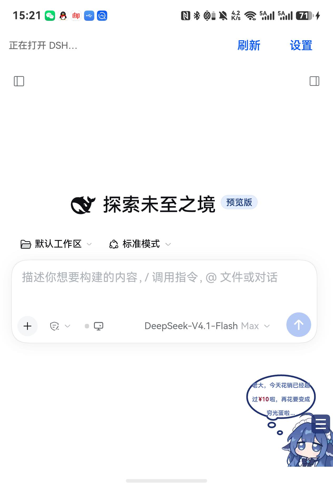

# DSH Remote

**把手机变成 DeepSeek Harness 的遥控器** —— 出门在外用手机给电脑上的 DSH 派活，活干完手机通知栏弹提醒。

> Put your DeepSeek Harness in your pocket: drive the desktop agent from a phone, get a notification when a turn finishes.
>
> Unofficial community project — not affiliated with DeepSeek.

[](https://github.com/deepseek-ai/deepseek-harness)
[](https://developer.huawei.com/consumer/cn/harmonyos/)
[](https://developer.android.com/)
[](LICENSE)
[](https://github.com/uchiha086/dshremote/releases/tag/v0.2.2-android)


---

## 它解决什么问题

DSH 是个桌面版 Agent，人离开了电脑就没法盯进度。现有的远程方案要么依赖第三方公网中继、要么只有 iOS/Android 没有鸿蒙，而我这台是 **HarmonyOS NEXT**（装不了 APK）。

所以自己做了一套：

- **电脑端一个插件**（`dshremote-bridge`）把 DSH 网页反代出来、把「回合结束」事件变成手机能拉的消息，并负责配对二维码、环境自检、隧道守护；
- **手机端一个壳 App**（鸿蒙 ArkTS + 安卓 Java 两份），全屏 WebView 直接跑 DSH 的 Web UI，后台轮询事件，回合结束发本地通知。

手机端不实现 DSH 协议，只做「壳 + 通知」——这把它从 30 人日的活压成了几个晚上。

## 看图

手机里打开就是完整的 DSH：会话列表、流式回复、模型选择、审批都在；回合结束手机通知栏会弹一条「会话标题 · done + 回复开头」。



## 特性

- **全屏 Web UI**：手机里就是 DSH 本体，会话、流式回复、审批、文件都在，不是阉割版
- **回合完成通知**：电脑跑完一个回合，手机通知栏弹「会话标题 · done + 回复开头」
- **扫码配对**：DSH 左下角一个二维码按钮，先做五项环境体检，通过才出码；码里是 60 秒一次性配对码，不是 token
- **双地址**：二维码里同时带局域网与固定公网地址，出门换网络不用重扫
- **固定地址（Tailscale Funnel）**：`https://<设备名>.<tailnet>.ts.net` 永久不变，电脑重启 / 换 Wi-Fi / 换 4G 都是同一个域名；桥启动回打 `/health` 自证、之后每 60 秒复核
- **自愈**：`/repair` 一键重拉隧道、`/ai-fix` 直接开一个 DSH 会话把诊断丢给 AI 去修
- **无额外依赖**：桥是零依赖 ESM 插件（自带二维码实现），安卓端纯 Java 无 Gradle

## 架构

```
┌─────────────┐   WebView(DSH UI)    ┌───────────────────────────────┐
│ 手机 App     │ ◀──────────────────▶ │ 电脑：dshremote-bridge 插件        │
│ 鸿蒙 ArkTS   │   /auth/cookie 注入   │  · 反代 DSH Web（7627）           │
│ 安卓 Java    │ ───────────────────▶ │  · 控制口 /pair /events（3088）    │
│             │   /events 每 3s 轮询  │  · 配对二维码 + 体检 + 隧道守护      │
└─────────────┘                      └──────────────┬────────────────┘
                                                    │ 同进程
                                     ┌──────────────▼────────────────┐
                                     │ DeepSeek Harness (Desktop)     │
                                     │ ctx.on('session/event') …      │
                                     └───────────────────────────────┘
        局域网：http://<pc-ip>:7627        公网：https://dsremote.<tailnet>.ts.net（固定）
```

## 获取方式

**安卓**：直接下载 [`dshremote-android-0.2.2.apk`](https://github.com/uchiha086/dshremote/releases/tag/v0.2.2-android)（41 KB，Android 7.0+，全平台通用，v2/v3 签名）。

**鸿蒙**：只发源码。因为开发签名会把证书绑定在签名人自己的设备 UDID 上（`.p7b` 里 `debug-info.device-ids` 只有一台），别人下载了也装不上——所以请按 [docs/使用与签名.md](docs/使用与签名.md) 用你自己的华为账号签名后构建。

**电脑端插件**：同样从源码装。

```powershell
git clone https://github.com/uchiha086/dshremote.git
cd dshremote
# 1) 把 bridge/ 装进 DSH profile（对 Agent 说一句「用 plugin_manager 装这个目录」），重启 Desktop
# 2) 手机端：安卓直接装 APK；鸿蒙按 docs/使用与签名.md 构建并签名
```

> 完整步骤、签名细节、故障排查：**[docs/使用与签名.md](docs/使用与签名.md)**

## 三步开始

1. 电脑装好桥插件并重启 Desktop；
2. DSH 左下角点二维码按钮 → 体检全绿后出码；
3. 手机 App 扫码 → 直接进 DSH 全屏界面，右上角只有一个设置齿轮。

出门在外：电脑上跑 `tools\tunnel.ps1`，二维码会自动带上公网地址。

完整步骤与排障表见 **[docs/使用说明.md](docs/使用说明.md)**，设计与踩坑见 **[开发计划.md](开发计划.md)**。

## 仓库结构

```
bridge/      电脑端插件（零依赖 ESM）：反代、配对、体检、隧道守护、二维码 SVG
  client.js  DSH 左下角面板（客户端插件，注册 sidebar.footer.action + shell.overlay）
app/         鸿蒙 HarmonyOS NEXT 客户端（ArkTS）
android/     安卓客户端（纯 Java，命令行 aapt2/d8/apksigner 构建）
tools/       tunnel.ps1（起隧道并登记）、图标生成
docs/        使用说明、使用与签名、图标
```

## 自己构建

**鸿蒙端**（DevEco Studio 的 hvigor，不用开 IDE）：

```powershell
$env:DEVECO_SDK_HOME='E:\dev\DevEco Studio\sdk'
cd app
& 'E:\dev\DevEco Studio\tools\hvigor\bin\hvigorw.bat' assembleHap --mode module -p product=default -p buildMode=debug --no-daemon
```

**安卓端**（一条命令，需 Android SDK build-tools 34 + 任意 JDK）：

```powershell
cd android
.\build.ps1
```

**桥插件**：改完 `bridge/` 直接重启 Desktop 生效（profile 里是 `link:` 安装，不要重新装）。

## 已知限制

- 通知依赖 App 进程存活：鸿蒙 ArkTS 的 WebSocket 发不出帧，两端都走 **3 秒 HTTP 轮询**，不是真正的推送
- 电脑休眠 / 关机 = 断；出门在外需要电脑保持开机
- Cloudflare 快速隧道地址每次重启都变、有配额限制；长期用建议换成命名隧道 + Access
- 安卓包只在构建机上做了静态验证（`aapt2 dump badging` / `apksigner verify` / dex 类清单），没有真机回归

## Roadmap

- [ ] 命名隧道 + Cloudflare Access（固定域名、带登录）
- [ ] 锁屏长时任务压测与断线重连
- [ ] 安卓真机回归、上架前的包名与签名整理
- [ ] 扫码直达指定会话（等 DSH 支持会话深链）

## License

[MIT](LICENSE) © 2026 uchiha086
